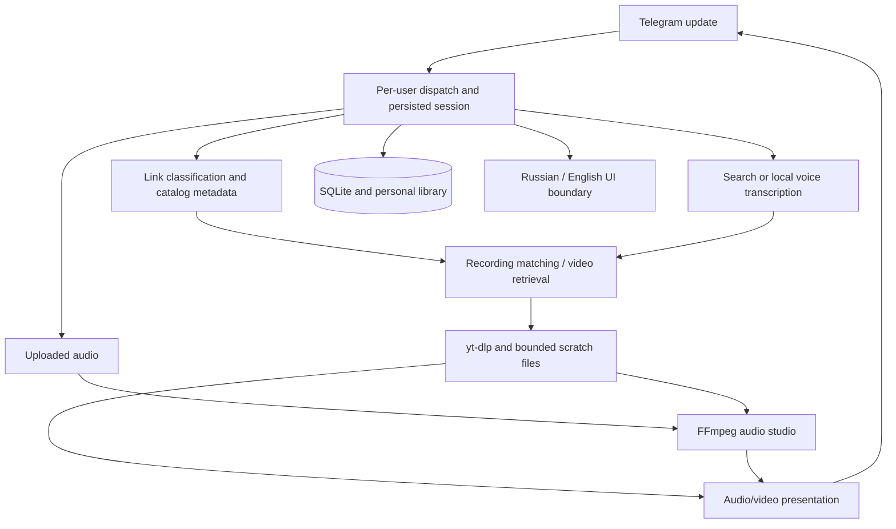

# Architecture

## Request flow

## Main modules

| Module | Responsibility |
| --- | --- |
| `bot.py` | Telegram application wiring and handlers |
| `dispatch.py`, `operations.py` | User serialization, operation status, cancellation |
| `catalog_links.py`, `versions.py` | Validated platform links, catalog metadata and recording selection |
| `link_queue.py` | Bounded sequential link batches |
| `track_card.py` | Immutable per-user card snapshots and compact navigation |
| `library_ui.py`, `uploaded_media.py` | Favourites, playlists and uploaded files |
| `studio_ui.py`, `studio_tools.py`, `quick_studio.py` | Audio tools and export flows |
| `i18n_ui.py`, `i18n_en.json` | Local UI translation, preserving user content |
| `state_store.py`, `media_store.py`, `scratch.py` | State, retained audio and private scratch cleanup |
| `tests/` | Offline unit and Telegram SDK integration tests |

## Engineering decisions

- Immutable callback snapshots keep old buttons tied to their original song and user.
- Successful downloads retire obsolete bot menus while preserving delivered media and user messages.
- Russian/English context is scoped per operation to prevent cross-user language leakage.
- Cancellation cooperates with worker threads and FFmpeg rather than abandoning cleanup.
- Audio/video output uses file metadata to preserve titles and display proportions.
- Public catalog identifiers are validated before using fallback metadata.
- SQLite and local volumes keep deployment small; this is a single-instance prototype, not a horizontally scaled service.
- Owner actions use explicit user-ID authorization. Paid external APIs are gated and disabled by default.

## Next engineering milestones

Measure concurrent workloads before expanding capacity. Separate heavy media workers from the update process when justified by measured queue latency. A Mini App, payments and production monitoring remain future work.
